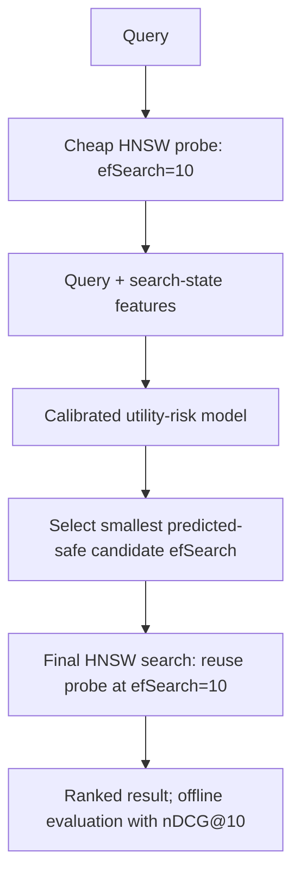
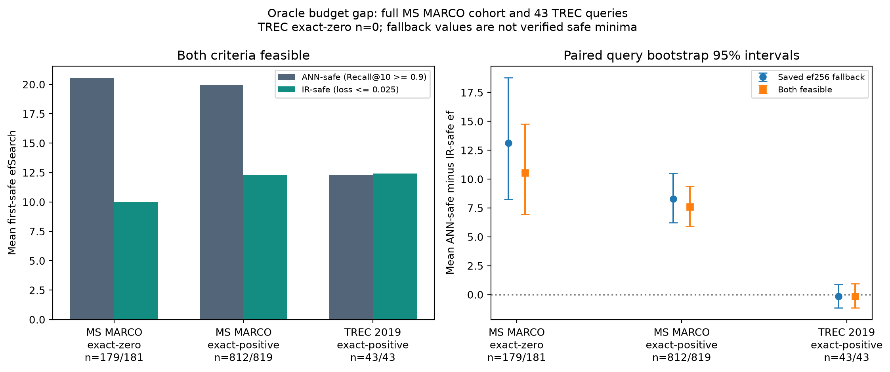
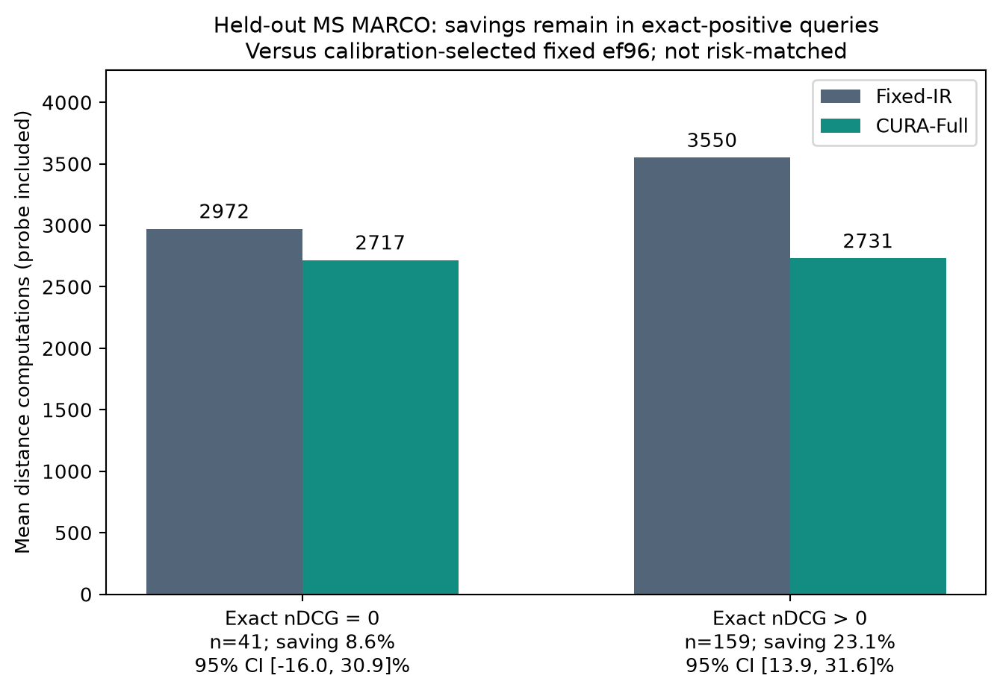
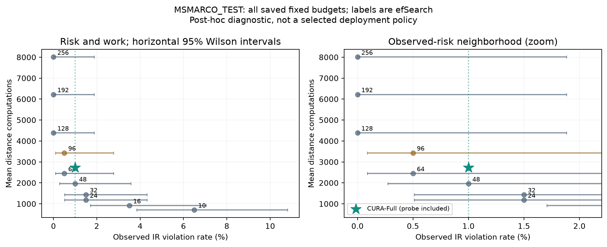
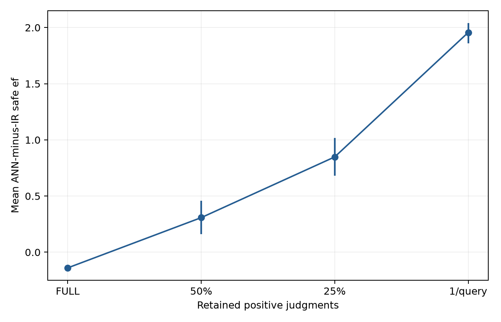
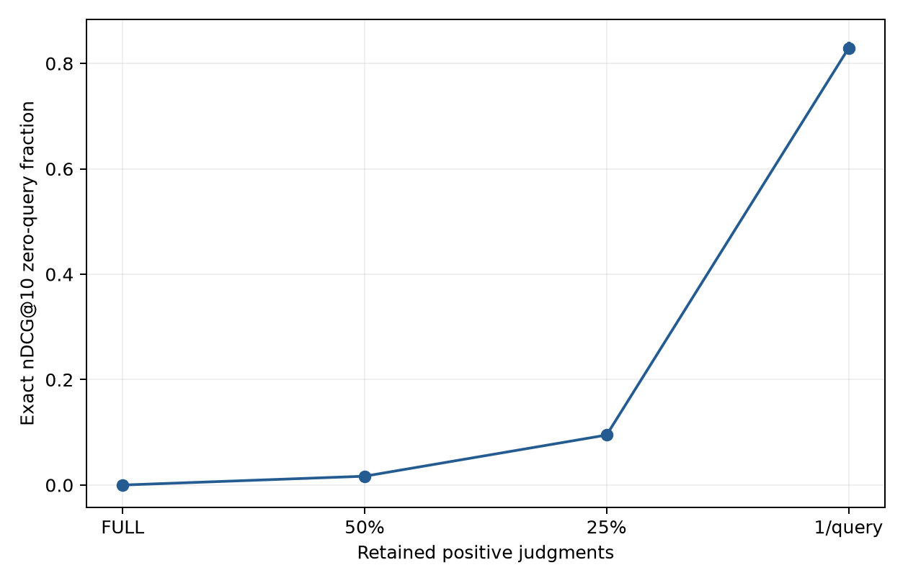

# CURA — Calibrated Utility-Risk Allocation for Query-Specific ANN Search

Query-specific approximate nearest-neighbor search guided by downstream retrieval utility rather than exact-neighbor recall alone.

## 1. Motivation

Approximate nearest-neighbor (ANN) search typically optimizes fidelity to exact neighbors, measured by metrics such as Recall@10. Retrieval systems ultimately care about the quality of the ranked results, measured here by nDCG@10. Missing an exact neighbor need not reduce downstream ranking quality: the missing item may be irrelevant, or another relevant result may preserve utility.

CURA studies whether search effort can be allocated query by query according to downstream information-retrieval (IR) risk. It distinguishes two criteria:

- **ANN-safe:** the approximate top ten recover at least 90% of the exact top-ten neighbors.
- **IR-safe:** approximate nDCG@10 falls no more than 0.025 below the exact-search reference under the available relevance judgments.

These criteria measure different properties. Neither establishes relevance beyond the available judgments.

## 2. CURA Method

CURA is a **two-stage query-specific HNSW budget allocator**. A cheap search provides query and search-state features; a calibrated model then selects the smallest candidate budget whose predicted violation risk satisfies the selected threshold.



The risk model is a `HistGradientBoostingClassifier` with isotonic calibration. Features combine query information, probe scores and score gaps, search counters, and the candidate budget. The candidate `efSearch` grid is:

```text
10, 16, 24, 32, 48, 64, 96, 128, 192, 256
```

Let `N_q*` be exact-search nDCG@10 and `N_q(e)` approximate nDCG@10 at budget `e`. Utility loss is:

```text
L_q(e) = max(0, N_q* - N_q(e))
```

An IR violation occurs when `L_q(e) > 0.025`; the separate ANN-safe criterion is `Recall@10 ≥ 0.90`. Relevance judgments provide offline training labels and evaluation, rather than online selection features.

The policy threshold is selected on calibration queries using a nominal 5% violation target and a Wilson upper-bound criterion. Predicted safety is not a guarantee for an individual query or a new distribution. If no candidate passes the predicted-risk threshold, the policy uses the largest candidate. At `efSearch=10`, it reuses the probe; larger budgets require a fresh search, and recorded work includes both the probe and the selected search.

## 3. Experimental Setup

### MS MARCO

The main experiment uses a controlled subset of **1,000,629 passages** and **1,000 development queries**, split into 600 training, 200 calibration, and 200 held-out test queries. The primary encoder is `msmarco-MiniLM-L6-cos-v5`. HNSW uses `M=32` and `efConstruction=200`; exhaustive inner-product retrieval supplies the exact reference.

The main metrics are nDCG@10, exact-neighbor Recall@10, HNSW distance computations, and search-component latency. Distance computations measure recorded search work rather than treating `efSearch` itself as a work counter.

### TREC DL 2019

The out-of-distribution evaluation contains **43 passage queries** over the same corpus. The relevance-judgment sensitivity experiment reuses the same exact and HNSW rankings across judgment conditions.

### FiQA

FiQA provides a separate financial-domain evaluation for robustness and failure analysis. Its simplified controller is fitted separately on FiQA queries; this evaluates adaptation to another domain, rather than zero-shot transfer of the MS MARCO model.

## 4. Main Results

### 4.1 ANN-safe and IR-safe budgets differ

Across the **819 exact-positive queries** among all 1,000 MS MARCO development queries, the saved first-safe budget summary is:

| Metric | Mean first-safe efSearch |
| --- | ---: |
| ANN-safe | 21.485 |
| IR-safe | 13.206 |
| Gap | 8.278 |

This summary substitutes the grid maximum, 256, when a criterion is never reached: four queries lack an ANN-safe candidate and three lack an IR-safe candidate. Restricting to the **812 jointly feasible queries** gives a **mean ANN-safe minus IR-safe gap of 7.611 efSearch units**, with a paired-query bootstrap 95% CI of **[5.933, 9.387]**.

These oracle comparisons show that preserving measured downstream utility can require a smaller search budget than preserving exact-neighbor recall. Budget differences describe an opportunity for allocating effort; they are not measured work savings.

<p align="center">
  
</p>

[Budget estimates and confidence intervals](sigir_analysis/oracle_budget_gap_analysis.csv).

### 4.2 CURA versus calibration-selected fixed baseline

On the 200-query MS MARCO held-out test set:

| Method | Observed IR violations | Mean work/query | Mean nDCG@10 |
| --- | ---: | ---: | ---: |
| Fixed efSearch=96 | 1/200 | 3431.77 | 0.6253 |
| CURA-Full | 2/200 | 2727.97 | 0.6234 |

CURA uses **20.51% less recorded HNSW work versus fixed efSearch=96**, the comparator selected prospectively on calibration data. The paired work difference is 703.805 distance computations per query, with a paired-query bootstrap 95% CI of [408.59, 985.82]. The observed violation counts do not establish equal risk.

Mean search-component latency falls from approximately 0.833 ms to 0.691 ms, while p95 worsens from approximately 1.128 ms to 1.985 ms. The current implementation improves average work and search latency but worsens p95 tail latency. These timings use saved per-query mean search times, including probe and rerun costs; they exclude controller inference and feature processing and are not end-to-end request timings.

[Paired work statistics](sigir_analysis/primary_statistical_results.csv) and [method metrics](sigir_analysis/fixed_risk_work_frontier.csv).

### 4.3 Exact-positive query analysis

The held-out test set contains **159 exact-positive queries** and **41 exact-zero queries**, defined by exact-search nDCG@10 under the available judgments. Within the exact-positive stratum, CURA saves **23.09%** of the fixed baseline's work. These queries contribute **92.59% of the total original work reduction** versus `efSearch=96`.

The original work reduction is therefore not mainly caused by trivial exact-zero queries.

<p align="center">
  
</p>

[Stratified results](sigir_analysis/exact_ndcg_stratified_results.csv).

### 4.4 Full fixed risk-work frontier

Selected points from the fixed-budget sweep show a different comparison:

| Method | Observed IR violations | Mean work/query |
| --- | ---: | ---: |
| Fixed efSearch=24 | 3/200 | 1182.79 |
| Fixed efSearch=48 | 2/200 | 1956.35 |
| Fixed efSearch=64 | 1/200 | 2448.65 |
| Fixed efSearch=96 | 1/200 | 3431.77 |
| CURA-Full | 2/200 | 2727.97 |

Post-hoc fixed `efSearch=48` matches CURA's observed **2/200** violation count and uses **28.29% less work than CURA**, with a paired-query bootstrap 95% CI of **[20.07%, 35.39%]**.

This is a **post-hoc diagnostic**, conditional on the saved policies and comparator. Matching an observed count does not prove prospective risk equivalence. It shows why adaptive ANN methods should be compared against the entire fixed risk-work frontier: this CURA controller does not dominate that frontier.

<p align="center">
  
</p>

[Full fixed-budget sweep](sigir_analysis/fixed_risk_work_frontier.csv) and [paired comparison](sigir_analysis/primary_statistical_results.csv).

## 5. Relevance-Judgment Sensitivity Experiment

This experiment isolates the effect of judgment availability. Exact rankings, HNSW rankings, ANN Recall@10, recorded work, and CURA's budget choices remain fixed. Only positive TREC relevance judgments are thinned; retained positives keep their original grades, and nonpositive judgments are preserved.

The conditions are FULL, 50% positives, 25% positives, and one positive per query. Each stochastic condition uses **50 paired thinning seeds**. FULL means all available pooled judgments, not exhaustive relevance truth.

### Budget-gap result

| Judgment condition | Mean ANN-safe − IR-safe gap |
| --- | ---: |
| FULL | -0.140 |
| 50% positives | 0.308 |
| 25% positives | 0.848 |
| One positive/query | 1.956 |

The changes versus FULL are **+0.447**, **+0.988**, and **+2.096** efSearch units, respectively. Each gap comparison has Holm-adjusted `p ≈ 6.0 × 10^-4` across the 12 density follow-up comparisons.

Inference uses thinning seeds as the resampling unit and is conditional on these 43 queries, their fixed rankings, and the thinning mechanism. The paired sign-flip tests assume sign exchangeability; they do not establish generalization to a broader query population. Reported bootstrap confidence intervals are unadjusted.

<p align="center">
  
</p>

[Judgment-density estimates](sigir_analysis/trec_judgment_density_summary.csv) and [seed-level statistical comparisons](sigir_analysis/density_statistical_tests_completed.csv).

### Exact-zero result

| Judgment condition | Exact-zero fraction |
| --- | ---: |
| FULL | 0.00% |
| 50% positives | 1.67% |
| 25% positives | 9.49% |
| One positive/query | 82.88% |

When exact nDCG@10 becomes zero, the one-sided loss is automatically zero for non-negative approximate nDCG@10. Sparse judgments can therefore make utility-aware ANN search appear safer even though the underlying rankings have not improved. This is a change in measured headroom, rather than evidence that true relevance was preserved.

<p align="center">
  
</p>

> **Sparse relevance judgments can inflate the measured utility-aware ANN headroom even when retrieval itself has not changed.**

## 6. FiQA Failure Analysis

Human review of model-prepared evidence for **50 fixed-HNSW `efSearch=10` IR failures** gives the following taxonomy. These are selected low-budget failures, rather than 50 failures of a deployed CURA policy.

| Failure category | Count | Share |
| --- | ---: | ---: |
| Relevant document dropped | 36 | 72% |
| Low ANN recall and IR failure | 11 | 22% |
| High ANN recall but IR failure | 2 | 4% |
| Ranking-boundary instability | 1 | 2% |

The dominant category is a relevant document dropped from the displayed approximate results. The displayed top-five evidence does not establish absence at every rank. Two cases also show that high ANN recall does not always guarantee downstream ranking stability. The single ranking-boundary label records the researcher's category choice; no boundary gap was recorded for that case, so a cutoff-instability mechanism is not established.

The separately fitted simplified CURA-FiQA controller provides a negative robustness result: it uses **75.27% more work** than its calibrated fixed comparator at the same observed violation rate of 3.05% (4/131 queries). This within-domain fit does not establish zero-shot transfer from MS MARCO.

[Human taxonomy](reports/HUMAN_50_FAILURE_TAXONOMY.csv), [qualitative evidence](reports/HUMAN_50_FAILURE_ANALYSIS.md), and [FiQA controller comparison](beir_fiqa/fiqa_cura_controller/heldout_comparison.csv).

## 7. Key Findings

1. **ANN recall and downstream IR utility are different optimization targets.**
2. **CURA reduces work versus the prospectively calibration-selected fixed efSearch=96 baseline.**
3. **The current two-stage CURA controller does not dominate the full fixed HNSW frontier.**
4. **Exact-positive queries account for 92.59% of the original saving, so the effect is not mainly a zero-nDCG artifact.**
5. **Judgment completeness materially changes the measured utility-aware optimization headroom.**

## 8. Repository Structure

| File / directory | Purpose |
| --- | --- |
| [`01_baseline_hnsw.py`](01_baseline_hnsw.py) | Exact versus HNSW pilot |
| [`02_ir_utility_labels.py`](02_ir_utility_labels.py) | Downstream utility labels |
| [`04_msmarco_large_pilot.py`](04_msmarco_large_pilot.py) | MS MARCO HNSW budget sweep |
| [`05_research_grade_validation.py`](05_research_grade_validation.py) | Query-level metrics and statistics |
| [`06_domain_specific_validation.py`](06_domain_specific_validation.py) | Domain-specific evaluation |
| [`07_cura_controller.py`](07_cura_controller.py) | Risk model, calibration, and allocation |
| [`08_patience_style_baseline.py`](08_patience_style_baseline.py) | Patience-inspired local proxy |
| [`09_final_ablation_package.py`](09_final_ablation_package.py) | Method comparisons and ablations |
| [`12_beir_fiqa_pilot.py`](12_beir_fiqa_pilot.py) | FiQA exact/HNSW budget sweep |
| [`13_fiqa_cura_controller.py`](13_fiqa_cura_controller.py) | Separately fitted FiQA controller |
| [`14_fiqa_failure_audit.py`](14_fiqa_failure_audit.py) | FiQA overhead and failure diagnostics |
| [`24_human_course_review.py`](24_human_course_review.py) | Interactive human failure review |
| [`msmarco_large/`](msmarco_large/) | MS MARCO metrics and policy outputs |
| [`beir_fiqa/`](beir_fiqa/) | FiQA results and qualitative evidence |
| [`sigir_analysis/`](sigir_analysis/) | Budget, frontier, and judgment-sensitivity analysis |
| [`reports/`](reports/) | Research reports and supporting evidence |
| [`REPRODUCIBILITY.md`](REPRODUCIBILITY.md) | Data prerequisites and experiment instructions |

## 9. Reproducibility

```bash
git clone https://github.com/Hrithikcrick/CURA-Query-Adaptive-ANN.git
cd CURA-Query-Adaptive-ANN
python -m venv .venv
```

Windows:

```powershell
.\.venv\Scripts\Activate.ps1
python -m pip install -r requirements.txt
```

Linux/macOS:

```bash
source .venv/bin/activate
python -m pip install -r requirements.txt
```

Large raw datasets, embeddings, FAISS indexes, and model caches are intentionally not committed. See [REPRODUCIBILITY.md](REPRODUCIBILITY.md) for data prerequisites, saved-result checks, and experiment regeneration instructions.

## 10. Scope and Limitations

- One primary encoder and one ANN family, HNSW.
- A controlled approximately 1M-passage MS MARCO subset rather than the full 8.8M corpus.
- A 43-query TREC out-of-distribution evaluation.
- FULL qrels are pooled judgments, not exhaustive relevance truth.
- The two-stage design pays probe plus rerun overhead when a larger budget is selected.
- Latency excludes controller inference and feature processing.
- Calibration data are reused for probability fitting and policy selection; observed violation rates are not universal or selection-adjusted risk guarantees.
- Post-hoc fixed comparators are diagnostic, not prospective guarantees.
- FiQA uses a separately fitted simplified controller; cross-domain model transfer is not established.
- ANN-Risk and Patience-inspired implementations are local proxies, not official DARTH or official Patience reproductions.

## Author

**Hrithik Sharma**<br>
Indian Institute of Technology Delhi<br>
Enrolment No. **2025JTM2082**
